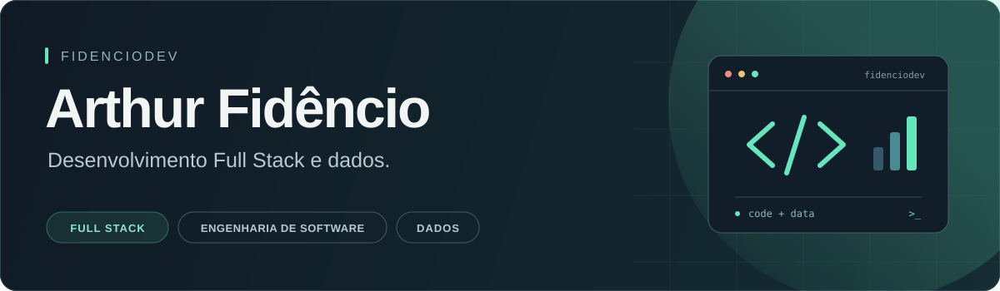

  

# Olá, eu sou o Arthur 👋

Desenvolvedor **Full Stack**, estudante de **Engenharia de Software — 4/8** e apaixonado pela área de **dados**.

Meus projetos passam por **interfaces web**, **APIs com Java e Spring Boot** e **análise de dados com Python**. Gosto de conectar o desenvolvimento de software com problemas do dia a dia.

## Tecnologias

**Linguagens**

  
  
  
  
  
  

**Web e APIs**

  
  
  
  
  
  

**Dados e bancos**

  
  
  
  

## Projetos em destaque

| Projeto | O que faz | Tecnologias principais |
| --- | --- | --- |
| [RoboParts](https://github.com/fidenciodev/roboparts) | Gestão de robôs e componentes, com autenticação, checklists de retirada e devolução e histórico da equipe. | React · TypeScript · Tailwind CSS · Java · Spring Boot · PostgreSQL |
| [Análise de vendas](https://github.com/fidenciodev/analise-vendas-python) | Análise de planilhas com indicadores de faturamento, ticket médio e gráficos por produtos, categorias, meses e lojas. | Python · pandas · Matplotlib · openpyxl |
| [Cadastro de veículos](https://github.com/fidenciodev/veiculo-crud) | CRUD no console com regras de negócio, arquitetura em camadas e integração com banco de dados via JDBC. | Java · SQL · MySQL · JDBC |
| [AutoManager](https://github.com/fidenciodev/automanager-fullstack) | API para cadastrar e listar veículos, com validação dos dados e persistência em banco de dados. | Java · Spring Boot · JPA · MySQL |

Também reúno [materiais de estudo sobre automação industrial, redes e sensores](https://github.com/fidenciodev/sistemas-automatizados).

[Explorar todos os meus repositórios →](https://github.com/fidenciodev?tab=repositories)
