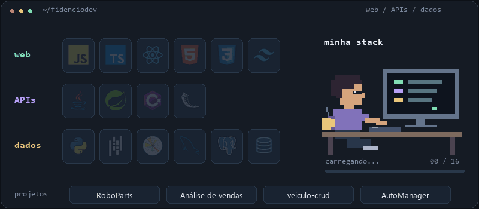

# Oi, eu sou o Arthur 👋

Faço **Engenharia de Software (4/8)** e curto desenvolvimento web e dados. Por aqui tem interfaces, APIs e algumas análises em Python.

  <picture>
    <source media="(prefers-reduced-motion: reduce)" srcset="./assets/stack-static.png">
    
  </picture>

### Minha stack

  
  
  
  
  
  
  
  
  
  
  
  

**Linguagens:** JavaScript, TypeScript, Python, C#, Java e SQL. 
**Web:** React, HTML/CSS, Spring Boot, Tailwind CSS e Flask. 
**Dados:** pandas, Matplotlib, MySQL e PostgreSQL.

### Alguns projetos

- [**RoboParts**](https://github.com/fidenciodev/roboparts) — robôs, componentes e checklists de retirada e devolução. React/TypeScript + Spring Boot.
- [**Análise de vendas**](https://github.com/fidenciodev/analise-vendas-python) — faturamento, ticket médio e gráficos com Python e pandas.
- [**Cadastro de veículos**](https://github.com/fidenciodev/veiculo-crud) — CRUD em Java e MySQL, direto no console.
- [**AutoManager**](https://github.com/fidenciodev/automanager-fullstack) — API em Spring Boot para cadastrar e listar veículos.

Também deixo aqui meus [estudos de automação industrial](https://github.com/fidenciodev/sistemas-automatizados).

[Ver todos os repositórios ↗](https://github.com/fidenciodev?tab=repositories)
